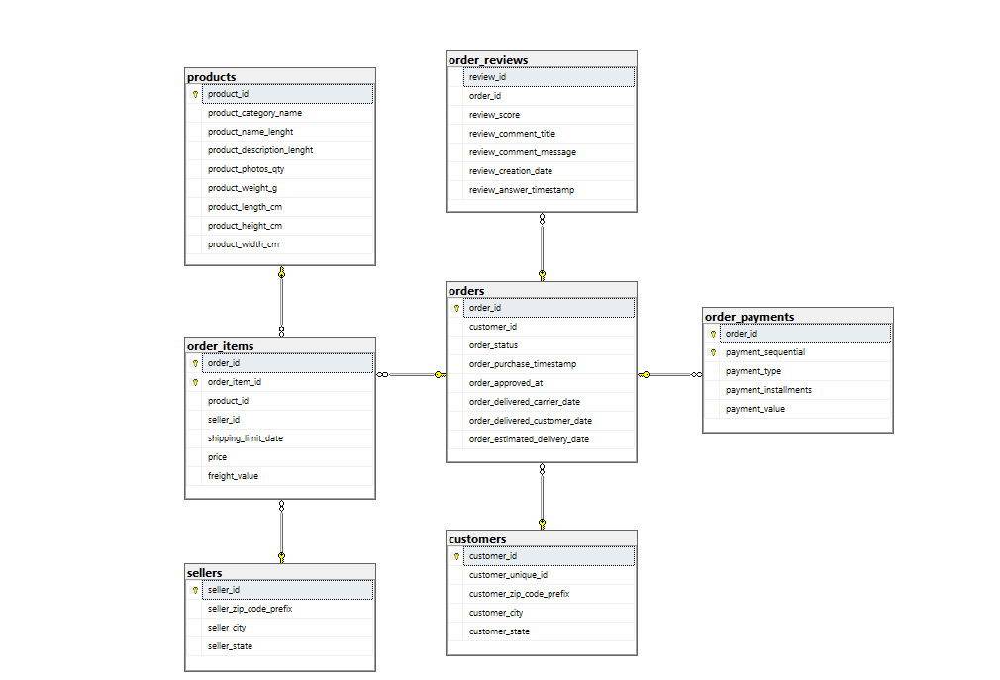

# Olist E-commerce: Late Deliveries, Customer Satisfaction and Where to Fix Them

SQL Server analysis of the public Olist Brazilian e-commerce dataset (about 100k orders, 2016-2018).
The project asks one business question: **do late deliveries hurt customer reviews and repeat purchases, and where should logistics be fixed first?**

**Tools:** SQL Server 2022 Express, SQL Server Management Studio (SSMS).
**SQL used:** multi-table JOINs, CTEs, window functions (`ROW_NUMBER`, `RANK`, `SUM() OVER`), `CASE WHEN` aggregation, `HAVING`, and a two-proportion z-test written in T-SQL.

## Key findings

| # | Finding | Numbers |
|---|---------|---------|
| 1 | Most orders arrive on time, but 1 in 12 is late | 7,826 of 96,470 delivered orders (8.11%) arrived after the estimated date |
| 2 | Late delivery is strongly linked to bad reviews | Average score 2.57 (late) vs 4.29 (on time). 54.0% of late-order reviews score 1-2 stars vs 9.2%, roughly 6x |
| 3 | Late first orders are linked to slightly lower repurchase | 2.52% vs 3.14% repeat rate (z = -2.99, p ~ 0.003). Statistically significant, but a small gap (~0.6 points) |
| 4 | Highest late rates are in small states | MA 19.67%, CE 15.32%, BA 14.04% (states with 500+ delivered orders) |
| 5 | Volume matters more than rate | SP and RJ together produce ~51.8% of all late orders. SP alone: 30.50% of late orders despite a below-average rate (5.89%). RJ: 13.47% late rate on 12,350 orders |
| 6 | Some sellers are consistently late | Among sellers with 100+ delivered orders, the worst 10 have late rates of 15.52%-23.14% (overall: 8.11%). The worst, in MA, has 90 late orders out of 389 |
| 7 | Orders grew fast in 2017 | Peak month 2017-11 (7,289 delivered orders, ~987.8K revenue); about 6,000-7,000 orders per month through 2018-08 |

## Recommendations

1. **Start with Rio de Janeiro (RJ).** It combines a high late rate (13.47%) with high volume (1,664 late orders, 21.26% of the total).
2. **Then Sao Paulo (SP).** Its rate is below average, but its size means that even a small improvement removes many late orders.
3. **Review the 10 worst sellers** (15.52%-23.14% late). Begin with the MA seller, which has the highest rate and a large order count.
4. **Do not prioritise states only by late rate.** MA and CE have the highest rates but contribute little to the total number of late orders.

These recommendations follow from the data, but the data shows association, not cause (see Limitations).

## Dataset

[Olist Brazilian E-Commerce Public Dataset](https://www.kaggle.com/datasets/olistbr/brazilian-ecommerce) on Kaggle: real, anonymised orders placed on Brazilian marketplaces. The CSV files are **not** included in this repository; download them from Kaggle and check the license on that page.

| Table | Rows |
|-------|------|
| customers | 99,441 |
| sellers | 3,095 |
| orders | 99,441 |
| order_items | 112,650 |
| order_reviews | 99,224 |
| order_payments | 103,886 |
| products | 32,951 |
| category_translation | 71 |
| geolocation | 1,000,163 |

All nine files were loaded. The seven queries below use customers, sellers, orders, order_items and order_reviews; the other tables are loaded for future work.

## Data model

`orders` is the centre of the model: one customer has many orders, and one order has many items, reviews and payments. Items link to products and sellers. Primary and foreign keys are created in `sql/00_setup_keys.sql`.

## Queries

Each file starts with a header: business question, tables, logic, finding and notes.

| File | Question | Techniques |
|------|----------|------------|
| `01_monthly_orders_revenue.sql` | How did orders and revenue evolve? | JOIN, GROUP BY |
| `02_late_delivery_rate.sql` | What share of delivered orders is late? | CASE WHEN aggregation |
| `03_review_score_late_vs_ontime.sql` | Do late orders get lower reviews? | JOIN, AVG, conditional counts |
| `04_late_delivery_by_state.sql` | Which states have the highest late rate? | HAVING (minimum 500 orders) |
| `05_worst_sellers_late_rate.sql` | Which sellers are late most often? | CTE, RANK (minimum 100 orders) |
| `06_repeat_purchase_after_late.sql` | Do customers with a late first order buy again less? | CTEs, ROW_NUMBER, COUNT OVER |
| `06b_repeat_purchase_ztest.sql` | Is that gap real or chance? | Two-proportion z-test |
| `07_delivery_fix_priority.sql` | Where should we fix delivery first? | CTE, SUM OVER, RANK |

## How to reproduce

1. Download the nine CSV files from Kaggle.
2. In SSMS, create a database named `olist` and import each CSV into a table with the names above (right-click the database, Tasks, Import Flat File). Check column types: zip code prefixes as text, `review_score` and `order_item_id` as `int`, prices as `decimal`, and allow NULLs in delivery date columns.
3. For `category_translation`, name the columns `product_category_name` and `product_category_name_english`, then delete the header row that was imported as data.
4. Run `sql/00_setup_keys.sql`, then the numbered query files in order.

## Limitations

- "Late" means delivered after the **estimated** delivery date. It does not measure how many days late an order was.
- Review counts and averages are per **review**, not per order; some orders have more than one review.
- Results show an **association**. Late orders may also differ in product, seller or distance, so lateness alone is not proven to cause the low scores.
- State is the **customer's** state. Lateness may reflect seller location and distance, not only the state.
- The thresholds (500 orders per state, 100 per seller) are judgment calls to avoid small-sample noise.
- Repeat purchase is rare in this dataset (about 3%), and "repeat" means any later order from the same `customer_unique_id`.
- The z-test counts in `06b` are typed in by hand from query 06.
- Revenue in query 01 is the sum of item prices for delivered orders (freight excluded). 2016 has very few orders because the platform was just starting.

## Part 2: Python and interactive dashboard

The follow-up project asks which orders are likely to arrive late, using purchase-time information only (pandas, scikit-learn): [python/](python/).

Interactive dashboard (4 pages, no install needed): https://dhaifallahms-source.github.io/olist-sql-delivery-analysis/dashboard/
