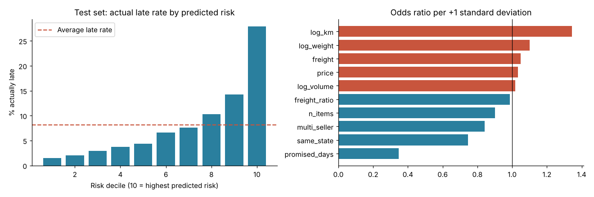

# Olist Python: Which Orders Are Likely to Arrive Late?

**Tools:** Python, pandas, matplotlib, scikit-learn | **Data:** Olist Brazilian E-Commerce dataset (public Kaggle, ~100k orders, 2016-2018)

Continuation of the [SQL delivery analysis](../README.md): the SQL project found that 8.11% of delivered orders arrive late and that late orders average 2.57 stars vs 4.29. This notebook asks what is known **at purchase time** that predicts a late delivery.



## Question
Can the riskiest orders be identified at purchase time, and what could be done about them?

## Approach
- Rebuilt the late flag from raw CSVs (96,470 delivered, 8.11% late), matching the SQL project.
- One row per order from purchase-time features only: seller-customer distance, same state, promised delivery days, product weight/volume, freight, price, items, sellers, month, weekday, states.
- Logistic regression (explainable) with a gradient-boosting model as a benchmark; random 75/25 split plus a time-based check.

## Findings
- Late rate rises with distance (6.4% under 100 km to 13.7% above 2,000 km); same-state orders are late 6.1% vs 9.3%.
- Logistic regression ROC-AUC 0.756 (benchmark gradient boosting 0.782). The highest-risk 10% of orders are late 27.9% of the time vs 1.5% for the lowest 10%; the top decile contains 34% of all late orders and the top two deciles 52%.
- On a time-based split (train before April 2018, test after) ROC-AUC falls to 0.675: the model still ranks risk but is weaker on future orders.
- Late-rate spikes in Nov 2017 and Feb-Mar 2018 are not explained by distance or size.
- Biggest route by volume: SP to RJ, late 15.5% of 8,141 orders (consistent with the SQL recommendation to fix Rio de Janeiro first).

## Decision
Give the riskiest 10% of orders a longer promised delivery date. Scenario: +5 days for that group lowers the overall late rate from 8.1% to about 7.1%. Run it as an A/B test first.

## Limitations
Observational data (no causal claim); weaker on future periods; zip-prefix distances, not real routes; the scenario keeps delivery times and demand fixed.

## Run it
```
pip install -r requirements.txt
# place the Olist CSV files from Kaggle in ../data/ (not committed, 126 MB)
jupyter notebook olist_late_delivery_risk.ipynb
```
Dataset: https://www.kaggle.com/datasets/olistbr/brazilian-ecommerce
